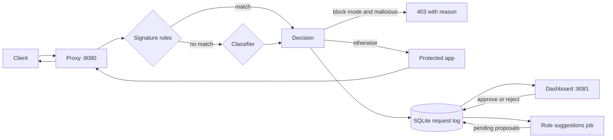

# Architecture

Chokidaar is a reverse proxy placed in front of one web application. Clients talk to Chokidaar; Chokidaar decides whether each request is safe and either forwards it to the application or refuses it with a plain-language reason.

## Components

| Part | Where | Job |
| --- | --- | --- |
| Reverse proxy | `proxy/app.py` | Receives every request, checks it, forwards or refuses it, passes the app's response back unchanged. |
| Signature rules | `proxy/rules.py` | 21 regular-expression rules for SQL injection, XSS, path traversal and command injection. A hit decides at once and the classifier is skipped. |
| Classifier | `ml/` | Character n-gram TF-IDF plus hand-made features into a logistic regression. Returns a score between 0 and 1, a label and the features behind a malicious call. |
| Request log | `proxy/logstore.py` | One SQLite row per request: time, IP, method, path, query, SHA-256 of the body, decision, rule id, score and reason. Also holds the rule proposals. |
| Rule suggestions | `proxy/suggest.py` | Reads recent blocked and flagged requests, asks a local language model for new rules, validates them and saves them as pending. |
| Dashboard | `dashboard/` | Token-protected admin page: summary, hourly timeline, top IPs, recent requests, and approve or reject for suggestions. |
| Packaging | `Dockerfile`, `docker-compose.yml`, `scripts/build_exe.ps1` | `docker compose up` with a test app, or a single `chokidaar.exe`. |

## What happens to a request

1. The proxy reads the method, raw path, raw query, headers and the first 64 KiB of the body.
2. The rules check each part as sent, after up to three rounds of URL decoding and with HTML entities decoded. The first matching rule decides.
3. If no rule matches, the classifier scores the request. A score of 0.5 or more is malicious.
4. In `block` mode a malicious request gets `403` and a text/plain explanation, and never reaches the application. In `monitor` mode everything is forwarded and the decision is recorded as `flagged`.
5. The decision is written to the request log. A logging failure never fails the request.
6. Allowed requests are forwarded unchanged, apart from hop-by-hop headers and `Host`. The application's status, headers and body come back as they are.

If the application cannot be reached the proxy answers `502`, or `504` on a timeout. If the classifier fails, block mode answers `503` and monitor mode forwards the request.

## Design decisions

- **Rules first, then the classifier.** Rules are exact, fast and easy to explain. The classifier covers variations the rules miss. A rule hit is final and the classifier is not asked.
- **Inbound requests only.** Responses are not inspected.
- **No raw bodies in the log.** Only a SHA-256 hash is stored, so the log cannot leak submitted passwords or personal data.
- **Plain-text refusals.** The block reason quotes part of the request, so it is sent as `text/plain` with `nosniff` and can never be rendered as HTML.
- **Human approval for new rules.** The language model only proposes. A rule takes effect after an admin approves it and the proxy restarts.
- **No client IP header trust.** The logged IP is the address of the connection; `X-Forwarded-For` can be forged.
- **Small, local model.** Logistic regression takes about 1 ms per request and needs no GPU, so the proxy ships as one container or one executable.

## Configuration

| Variable | Used by | Meaning |
| --- | --- | --- |
| `UPSTREAM_URL` | proxy | The application to protect (required). |
| `MODE` | proxy | `block` (default) or `monitor`. |
| `LOG_DB` | proxy, dashboard, suggestions | SQLite file, default `logs/chokidaar.db`. |
| `CHOKIDAAR_MODEL` | proxy | Path to a trained model file. |
| `CHOKIDAAR_THRESHOLD` | proxy | Score at or above which the classifier calls a request malicious, default 0.5. |
| `ADMIN_TOKEN` | dashboard | Required. The dashboard refuses to start without it. |
| `DASHBOARD_PORT` | dashboard | Default 8081. |
| `SUGGEST_URL`, `SUGGEST_MODEL` | suggestions | Local Ollama server and model name. |
